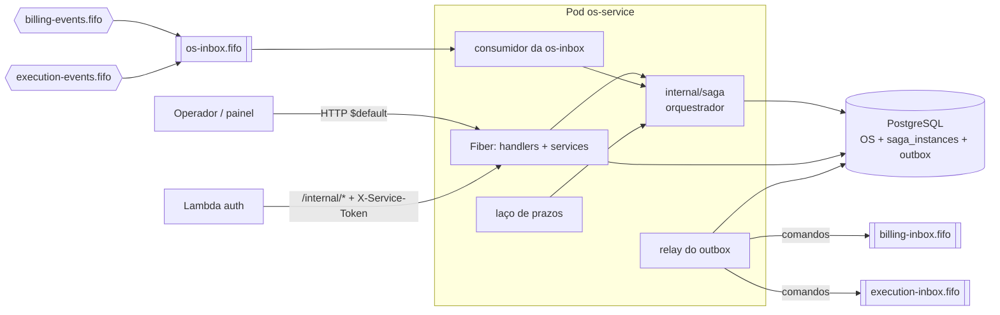
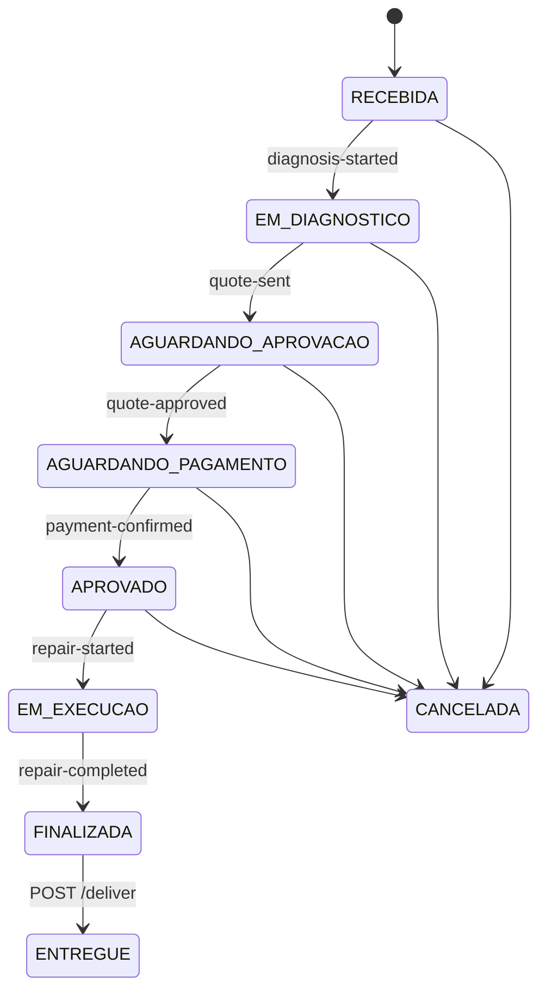

# oficina-mecanica-os-service

OS Service da Fase 4: dono da ordem de serviço, dos itens e snapshots de preço,
do status e do histórico, dos catálogos (clientes, veículos, serviços, insumos e
estoque) e dos usuários — e **orquestrador da Saga** que coordena Billing e
Execution ([RFC-0006][rfc6], [ADR-0013][adr13]).

Go 1.26 + Fiber v3, arquitetura hexagonal, PostgreSQL próprio (RDS), SQS/SNS FIFO
com outbox transacional. Nasceu do `oficina-mecanica-monolith` da Fase 3; o
diretório e o remote ainda têm o nome antigo, o module path já é
`github.com/SOAT-15-Oficina/oficina-mecanica-os-service`.

## O que este serviço **não** faz mais

| Responsabilidade | Onde vive agora |
|---|---|
| Gerar e enviar orçamento, links de aprovação (`/public/approvals/*` → `/billing/public/quotes/*`) | [`oficina-mecanica-billing-service`](https://github.com/SOAT-15-Oficina/oficina-mecanica-billing-service) |
| Cobrança no Mercado Pago, webhook, estorno | Billing |
| Fila da bancada, diagnóstico, início/fim de item (`start`/`finalize`) | [`oficina-mecanica-execution-service`](https://github.com/SOAT-15-Oficina/oficina-mecanica-execution-service) |
| Troca livre de status por `PUT /work-orders/{id}` | a Saga (status é efeito de mensagem) |
| Emitir JWT (`/auth/login`, `/auth/register`) | Lambda em `oficina-mecanica-serverless`, que chama `/internal/*` daqui |

## Arquitetura



Consumidor, relay e laço de prazos são goroutines no mesmo processo da API
(`cmd/api/workers.go`). Um `SIGTERM` para de aceitar requisições
(`ShutdownWithTimeout`), cancela o contexto dos três laços e espera eles
terminarem. O modo `migrate` (`/os-service migrate`) continua existindo e roda
como Job antes do rollout.

**Regra de ouro.** Em toda mudança da Saga, o efeito na OS, o `MarkProcessed`
da mensagem recebida, o `UPDATE` da `saga_instances` e o `Enqueue` do próximo
comando acontecem na **mesma transação**. Nada é publicado direto do handler; o
relay lê o `outbox` e publica (`internal/messaging`, copiado sem mudanças do
billing-service).

## Máquina de estados da OS



`APROVADO` significa aprovado **e pago**. Toda transição grava
`work_order_status_history` (de, para, causa, `message_id`, instante, `seq`). A
causa é o tipo da mensagem (`billing.quote-approved`) ou a ação
(`work_order.opened`, `operator.deliver`). `CANCELADA` só é gravada quando a
última compensação é confirmada.

## Saga

Estado em `saga_instances`: `status` (`STARTED`, `COMPENSATING`, `COMPLETED`,
`COMPENSATED`, `FAILED`), `current_step`, `completed_steps`,
`pending_compensations`, `deadline_at`, `attempts`, `last_command` (destino +
envelope, para reenvio), `quote_id`, `failure_reason` e `version`. Todo
`UPDATE` é `WHERE version = $n` (concorrência otimista); conflito devolve erro
e a mensagem volta para a fila.

### Mensagens tratadas

| Mensagem | Passo exigido | Efeito no OS | Próximo comando |
|---|---|---|---|
| (abertura, `POST /work-orders`) | — | OS `RECEBIDA` + saga `STARTED` | `execution.schedule-diagnosis` (filial, código, título, veículo) |
| `execution.diagnosis-scheduled` | `SCHEDULE_DIAGNOSIS` | passo `AWAIT_DIAGNOSIS`, sem prazo | — |
| `execution.diagnosis-started` | `AWAIT_DIAGNOSIS` | `EM_DIAGNOSTICO` | — |
| `execution.diagnosis-completed` | `AWAIT_DIAGNOSIS` | total estimado; sem itens → compensa `SEM_ITENS`; cliente sem e-mail → compensa `SEM_EMAIL` | `billing.create-quote` (cliente, itens com preço do serviço + insumos, falta de insumo) |
| `billing.quote-sent` | `CREATE_QUOTE` | `AGUARDANDO_APROVACAO`, guarda `quote_id`, prazo `SAGA_APPROVAL_TIMEOUT` | — |
| `billing.quote-approved` | `AWAIT_APPROVAL` | itens aprovados/reprovados, `approved_total_cents`, `AGUARDANDO_PAGAMENTO` (lista vazia = reprovação) | `billing.request-payment` (`quote_id`) |
| `billing.quote-rejected` | `AWAIT_APPROVAL` | caso A | `execution.cancel-ticket` |
| `billing.payment-requested` | `REQUEST_PAYMENT` | `payment_url` = `checkout_url`, prazo `SAGA_PAYMENT_TIMEOUT` | — |
| `billing.payment-confirmed` | `AWAIT_PAYMENT` | `APROVADO`, reserva de insumos | `execution.enqueue-repair` (itens aprovados) |
| `billing.payment-failed` | `REQUEST_PAYMENT`, `AWAIT_PAYMENT` | caso B | `billing.cancel-quote`, depois `execution.cancel-ticket` |
| `execution.repair-enqueued` | `ENQUEUE_REPAIR` | **pivô**; passo `AWAIT_REPAIR` | — |
| `execution.repair-rejected` | `ENQUEUE_REPAIR` | caso C: libera a reserva | `billing.refund-payment`, depois `execution.cancel-ticket` |
| `execution.repair-started` | `AWAIT_REPAIR` | `EM_EXECUCAO` | — |
| `execution.item-started` / `item-finished` | `AWAIT_REPAIR` | `started_at`/`finished_at` e status do item; no fim do item consome a reserva (baixa de estoque) | — |
| `execution.repair-completed` | `AWAIT_REPAIR` | `FINALIZADA`, saga `COMPLETED` | — |
| `execution.ticket-canceled`, `billing.quote-canceled`, `billing.payment-refunded` | saga `COMPENSATING` | confirma a compensação da vez; sem pendências → `CANCELADA`, saga `COMPENSATED` | próxima compensação |

Mensagem que não casa com o passo (fora de ordem, repetida com outro
`message_id`, saga já terminada, saga desconhecida ou `saga_id` diferente) é
marcada em `processed_messages` e logada como `saga.message_ignored`, sem
efeito. Mensagem com o mesmo `message_id` é barrada pelo `MarkProcessed`. O
casamento é por `saga_id`/`work_order_id` + tipo + passo atual — nunca por
`causation_id`/`correlation_id`, que os eventos disparados por cliente ou
webhook não carregam.

`repair-completed` sem `repair-started` antes (reparo sem itens) passa por
`EM_EXECUCAO` na mesma transação, para o histórico continuar coerente.

### Compensações

Na ordem inversa dos passos, **uma de cada vez**: o próximo comando só sai
depois da confirmação do anterior, e cada um tem prazo e reenvio próprios.

| Situação | Pendências | Motivo |
|---|---|---|
| A. cliente reprova (`quote-rejected` ou aprovação vazia) | `cancel-ticket` | `CLIENTE` / `PRAZO` |
| prazo de aprovação vencido | `cancel-quote`, `cancel-ticket` | `PRAZO` |
| B. `payment-failed` ou prazo de pagamento vencido | `cancel-quote`, `cancel-ticket` | `RECUSADO` / `EXPIRADO` |
| C. `repair-rejected` | libera reserva; `refund-payment`, `cancel-ticket` | `BANCADA_INDISPONIVEL` (ou o que o Execution mandar) |
| cancelamento pelo operador antes do pivô | conforme o que já foi feito (inclui `refund-payment` se já pagou) | `CANCELADA_PELO_OPERADOR` |
| diagnóstico sem itens / cliente sem e-mail | `cancel-quote`, `cancel-ticket` | `SEM_ITENS` / `SEM_EMAIL` |
| comando sem resposta após `SAGA_MAX_ATTEMPTS` | conforme o que já foi feito | `SEM_RESPOSTA` |

Regra: `refund-payment` se o pagamento foi confirmado; `cancel-quote` se o
orçamento foi pedido, não foi pago e o cliente não o reprovou; `cancel-ticket`
sempre. Os participantes respondem aos cancelamentos mesmo sem recurso, então a
compensação não trava. Um `payment-confirmed` que chega durante a compensação
acrescenta o estorno logo depois da pendência da vez.

### Prazos e reenvio

O laço de prazos (`SAGA_TICK`) faz
`SELECT ... FOR UPDATE SKIP LOCKED` nas sagas vencidas, então várias réplicas
dividem o trabalho sem pegar a mesma linha:

| Passo vencido | Ação |
|---|---|
| aguardando resposta de comando (`SAGA_COMMAND_TIMEOUT`) | reenvia o `last_command` com o **mesmo** `message_id` (a linha do outbox volta a pendente), `attempts++`, log `saga.command_retried` |
| `attempts` = `SAGA_MAX_ATTEMPTS` | compensa (`SEM_RESPOSTA`); se já estava compensando, saga `FAILED` (log `saga.failed`) |
| `AWAIT_APPROVAL` (`SAGA_APPROVAL_TIMEOUT`) | reprovação, caso A com motivo `PRAZO` |
| `AWAIT_PAYMENT` (`SAGA_PAYMENT_TIMEOUT`) | caso B com motivo `EXPIRADO` |

O SQS FIFO e os participantes deduplicam pelo `message_id`, então o reenvio só
produz efeito quando o comando original se perdeu antes de chegar; a resposta
original continua no outbox do participante.

### Logs

Atributos do `slog` (não texto da mensagem): `event`, `saga_id`,
`work_order_id`, `message_type`, `step` e, quando houver, `reason`. Eventos:
`saga.started`, `saga.step_completed`, `saga.compensation_started`,
`saga.compensated`, `saga.completed`, `saga.failed`, `saga.message_ignored`,
`saga.command_retried`, além de `work_order.status_changed` com `from`, `to` e
`duration_ms` (tempo no status anterior, a partir do histórico).

### Reserva de insumos

Tabela `supply_reservations` (uma linha por item aprovado × insumo, status
`RESERVADA` → `LIBERADA` | `CONSUMIDA`), e não uma coluna `reserved_quantity`
em `supplies`. Motivos: reservar, liberar e consumir viram `UPDATE`s de status
idempotentes (`ON CONFLICT DO NOTHING` na criação), a compensação não precisa
recalcular quantidades nem corre risco de devolver duas vezes, e fica o rastro
de quanto cada OS reservou. A reserva nasce no `payment-confirmed`, é liberada
no caso C ou no cancelamento e é consumida no `item-finished` (baixa no
`stock_quantity`); o que sobrar é consumido no `repair-completed`. A falta de
insumo enviada no `create-quote` considera o estoque menos as reservas ativas.

## Endpoints

Sem prefixo (o gateway manda `$default` para cá). Rotas de operador exigem JWT
com role `admin` ou `employee`; `/users` só `admin`.

| Rota | Função |
|---|---|
| `/customers`, `/vehicles`, `/services` (+ `/services/avg-execution-time`), `/supplies` (+ `/pending-purchases`), `/users` | catálogos e usuários, como no monólito |
| `POST /work-orders` | abre a OS **e inicia a Saga** (OS + saga + outbox numa transação) |
| `GET /work-orders`, `GET /work-orders/{id}`, `PUT /work-orders/{id}` | listagem, detalhe, edição de título/descrição/técnico (`status` no corpo → 400) |
| `POST/DELETE /work-orders/{id}/services...`, `.../supplies...` | itens e insumos, só em `RECEBIDA` ou `EM_DIAGNOSTICO` |
| `POST /work-orders/{id}/deliver` | `FINALIZADA` → `ENTREGUE` (422 fora disso) |
| `POST /work-orders/{id}/cancel` | antes do pivô inicia a compensação (202 + saga); depois, 409 |
| `GET /work-orders/{id}/history` | histórico de status com causa e `message_id` |
| `GET /work-orders/{id}/saga` | linha da `saga_instances` |
| `GET /public/work-orders/{code}?document=CPF` | consulta pública, agora com `history` e `payment_url` (só em `AGUARDANDO_PAGAMENTO`) |
| `POST /internal/credentials/verify` | `{"username","password"}` → 200 `{"id","username","role"}` ou 401 |
| `POST /internal/users` | `{"username","password","role"}` → 201, 409 duplicado, 400 `{"error"}` |
| `/ping`, `/ready`, `/docs/swagger.yaml`, `/swagger` | saúde e contrato (swagger embutido no binário) |

As rotas `/internal/*` exigem `X-Service-Token` igual a
`INTERNAL_SERVICE_TOKEN`, comparado em tempo constante; sem token configurado,
tudo responde 401. O hash de senha é o argon2id da Lambda (`t=1`, `m=64 MiB`,
`p=4`, chave de 32 bytes, sal de 16), lido do próprio hash na verificação.

`internal/routes/openapi_test.go` falha se uma rota registrada não estiver no
`docs/swagger.yaml` ou vice-versa; o CI roda `redocly lint` com o
`redocly.yaml` do repositório.

A notificação de mudança de status por e-mail ao cliente continua aqui
(`EMAIL_PROVIDER` `mailhog` | `ses`), exceto em `AGUARDANDO_APROVACAO`, cujo
e-mail é o orçamento do Billing. Cliente sem e-mail é pulado com aviso no log.

## Variáveis de ambiente

Ver `.env.example`.

| Variável | Padrão | Uso |
|---|---|---|
| `DATABASE_*` | — | Postgres do OS |
| `JWT_SECRET_KEY` | — | mesmo valor da Lambda (HS256) |
| `INTERNAL_SERVICE_TOKEN` | — | token das rotas `/internal/*` (segredo da plataforma) |
| `MESSAGING_INBOX_QUEUE_URL` | — | `os-inbox.fifo`; vazia desliga o consumidor |
| `BILLING_INBOX_QUEUE_URL`, `EXECUTION_INBOX_QUEUE_URL` | — | destino dos comandos |
| `MESSAGING_POLL_WAIT` | `20s` | long polling |
| `OUTBOX_POLL_INTERVAL` | `500ms` | intervalo do relay |
| `AWS_DEFAULT_REGION`, `AWS_ENDPOINT_URL` | `sa-east-1`, — | região; endpoint só no LocalStack |
| `SAGA_TICK` | `1s` | intervalo do laço de prazos |
| `SAGA_COMMAND_TIMEOUT` | `30s` | prazo de resposta de comando |
| `SAGA_MAX_ATTEMPTS` | `5` | envios antes de compensar |
| `SAGA_APPROVAL_TIMEOUT` | `168h` | prazo de decisão do cliente |
| `SAGA_PAYMENT_TIMEOUT` | `48h` | prazo de pagamento |
| `DEFAULT_BRANCH` | `MATRIZ` | filial gravada na abertura |
| `EMAIL_*`, `SES_*` | — | notificação de status |
| `DD_ENV`, `DD_SERVICE` (`os-service`), `DD_TRACE_ENABLED` | — | observabilidade |

## Rodando local

```bash
cp .env.example .env      # ajuste DATABASE_PASSWORD
docker compose up --build
```

| Serviço | Porta no host |
|---|---|
| API | 8090 |
| Postgres | 5434 |
| LocalStack (SQS/SNS) | 4568 |
| MailHog (UI) | 8026 |

O LocalStack cria `os-inbox.fifo`, `billing-inbox.fifo` e
`execution-inbox.fifo` (cada uma com DLQ, `maxReceiveCount` 5), os tópicos
`billing-events.fifo` e `execution-events.fifo` e as assinaturas raw delivery
da `os-inbox` (`local/localstack/init.sh`). Billing e Execution não sobem aqui:
os comandos ficam nas filas deles, e um evento pode ser simulado publicando no
tópico. O ambiente com tudo junto é o `docker-compose.local.yml` do
`oficina-mecanica-infrastructure`.

Usuário e token:

```bash
curl -XPOST localhost:8090/internal/users -H 'X-Service-Token: local-internal-token' \
  -H 'Content-Type: application/json' -d '{"username":"admin","password":"pw","role":"admin"}'
JWT_SECRET_KEY=local-dev-secret go run ./tests/tools/token -role admin -user admin
```

## Teste BDD do fluxo completo

`tests/bdd/` exercita a Saga atravessando os três microsserviços reais, com
[godog](https://github.com/cucumber/godog) e cenários em português em
`tests/bdd/features/ciclo_da_ordem_de_servico.feature`:

| Cenário | O que prova |
|---|---|
| OS paga é executada até o fim | caminho feliz: 7 transições na ordem, saga `COMPLETED` |
| cliente reprova o orçamento | caso A: compensação cancela a ficha da bancada |
| QR Code do pagamento expira sem ser pago | caso B: `payment-failed` (`EXPIRADO`) cancela orçamento e ficha |
| bancada recusa o reparo depois do pagamento | caso C: estorno no Mercado Pago, reserva liberada, ficha cancelada |

Roda contra o ambiente local completo do `oficina-mecanica-infrastructure`:

```bash
cd ../oficina-mecanica-infrastructure
docker compose -f local/docker-compose.local.yml up -d --build --wait
cd ../oficina-mecanica-monolith/tests/bdd
go test -tags bdd -count=1 -v .
```

O pagamento é por QR Code dinâmico (Orders API do Mercado Pago). Os passos de
pagamento leem o id da order em `GET /billing/quotes/by-work-order/{id}`
(`payments[-1].provider_order_id`) e acionam o fake do Mercado Pago:
"o Mercado Pago confirma o pagamento" faz `POST {mpfake}/__orders/{id}/pay` e
"o QR Code do pagamento expira" faz `POST {mpfake}/__orders/{id}/expire`; o
fake chama o webhook do Billing como o Mercado Pago real. Order QR não tem
recusa (um cartão recusado no app só deixa a order expirar), por isso o caso B
é a expiração.

`BDD_API_URL` (padrão `http://localhost:8080/api`) e `BDD_MPFAKE_URL` (padrão
`http://localhost:8095`) apontam para outro ambiente. A build tag `bdd` deixa
esses testes fora do `go test ./...` comum e da métrica de cobertura. No CI, o
job `bdd` faz checkout dos repositórios irmãos, sobe o mesmo compose e roda os
cenários em todo Pull Request.

## Testes e cobertura

```bash
docker run -d --rm --name os-pg -e POSTGRES_USER=techchallenge -e POSTGRES_PASSWORD=password \
  -e POSTGRES_DB=techchallenge-db -p 55442:5432 postgres:17-alpine
export DATABASE_HOST=localhost DATABASE_PORT=55442 DATABASE_USER=techchallenge \
  DATABASE_PASSWORD=password DATABASE_NAME=techchallenge-db
go test ./... -race -p 1 -coverpkg=./... -coverprofile=coverage.out -covermode=atomic
./scripts/coverage-gate.sh coverage.out
```

Sem `DATABASE_HOST` os testes de banco são pulados. `-p 1` porque vários
pacotes recriam o schema `public` do mesmo banco. `-coverpkg=./...` conta o que
os testes de integração exercitam em outros pacotes (repositórios). O gate e o
Sonar excluem o mesmo conjunto: `cmd/`, `database/`, `docs/` e `tests/`.

Os testes do orquestrador (`internal/saga`) rodam contra o Postgres real com
relógio controlado: caminho feliz até `ENTREGUE` (incluindo o tempo médio de
execução vindo de `item-started`/`item-finished`), casos A, B e C, cliente sem
e-mail, OS sem itens, cancelamento antes e depois do pivô, pagamento tardio
durante a compensação, reenvio com o mesmo `message_id` até o limite, prazos de
aprovação e pagamento, mensagem duplicada, fora de ordem, de outra saga e
depois do fim, e conflito de versão.

Cobertura medida em 2026-11-11 (`scripts/coverage-gate.sh`): **83,3%**.

| Pacote | Cobertura |
|---|---|
| `internal/application` | 100,0% |
| `internal/auth` | 91,7% |
| `internal/config` | 100,0% |
| `internal/database` | 81,1% |
| `internal/domain` | 97,6% |
| `internal/handler` | 92,2% |
| `internal/messaging` | 95,6% |
| `internal/messaging/pgoutbox` | 88,6% |
| `internal/observability` | 80,0% |
| `internal/repository` | 60,8% |
| `internal/routes` | 100,0% |
| `internal/routes/middlewares` | 97,6% |
| `internal/saga` | 84,7% |
| `internal/service` | 97,1% |
| `packages/email` | 45,1% |

## Infraestrutura e deploy

Como os outros serviços ([ADR-0017][adr17]):

```
infra/   Terraform, state <env>/os-service/terraform.tfstate
k8s/     kustomize: Deployment, Service, HPA, PDB, ServiceAccount (IRSA), TargetGroupBinding
```

O Terraform lê do SSM (`/oficina-mecanica/<env>/`) a VPC, as subnets, o
namespace, o OIDC do EKS, o SG dos nós, o listener do ALB e, dos outros
serviços, `billing_events_topic_arn`, `execution_events_topic_arn`,
`billing_inbox_queue_arn` e `execution_inbox_queue_arn`. Cria:

- RDS PostgreSQL `oficina-<env>-os` e o SG que só aceita os nós do EKS;
- `oficina-<env>-os-inbox.fifo` + DLQ, com policy que só aceita
  `sns.amazonaws.com` vindo dos dois tópicos, e as assinaturas raw delivery;
- role IRSA: consumir a `os-inbox`, `sqs:SendMessage` nas filas de Billing e
  Execution, SES;
- ECR `oficina-mecanica/<env>/os-service` e o segredo
  `oficina-mecanica/<env>/os-service` com a senha do banco;
- target group e regra **catch-all `/*` com prioridade 100** no listener do ALB
  interno (Billing usa 20, Execution 30).

Publica no SSM, com prefixo `os_`: fila e DLQ, ECR, endpoint/nome/usuário do
banco, segredo, role, target group e SG do banco. `INTERNAL_SERVICE_TOKEN` e
`JWT_SECRET_KEY` são segredos da plataforma (`internal_service_token_secret_arn`,
`jwt_secret_arn`); o pipeline os injeta no Secret `os-secrets`.

| Gatilho | Jobs |
|---|---|
| PR → `main`/`hml` | lint (actionlint, redocly, `terraform fmt`/`validate`, kubeconform), test (Postgres + gate de 80%), quality (SonarQube efêmero, Quality Gate com cobertura ≥ 80%) |
| push → `main`/`hml` | deploy: `terraform apply`, build e push no ECR, Secret, `kubectl apply` do overlay, Job `migrate`, rollout, smoke (`/ready`, `/ping`, swagger servido igual ao do repositório) |

A branch escolhe o ambiente (`hml` → homologação, `main` → produção). Secrets e
variables: `AWS_DEPLOY_ROLE_ARN` (de Environment), `AWS_REGION` e
`SES_SENDER_EMAIL` (variables).

[rfc6]: https://github.com/SOAT-15-Oficina/oficina-mecanica-infrastructure/blob/main/docs/rfc/0006-microsservicos-e-saga.md
[adr13]: https://github.com/SOAT-15-Oficina/oficina-mecanica-infrastructure/blob/main/docs/adr/0013-saga-orquestrada-no-os-service.md
[adr17]: https://github.com/SOAT-15-Oficina/oficina-mecanica-infrastructure/blob/main/docs/adr/0017-infra-e-manifestos-no-repositorio-do-servico.md
